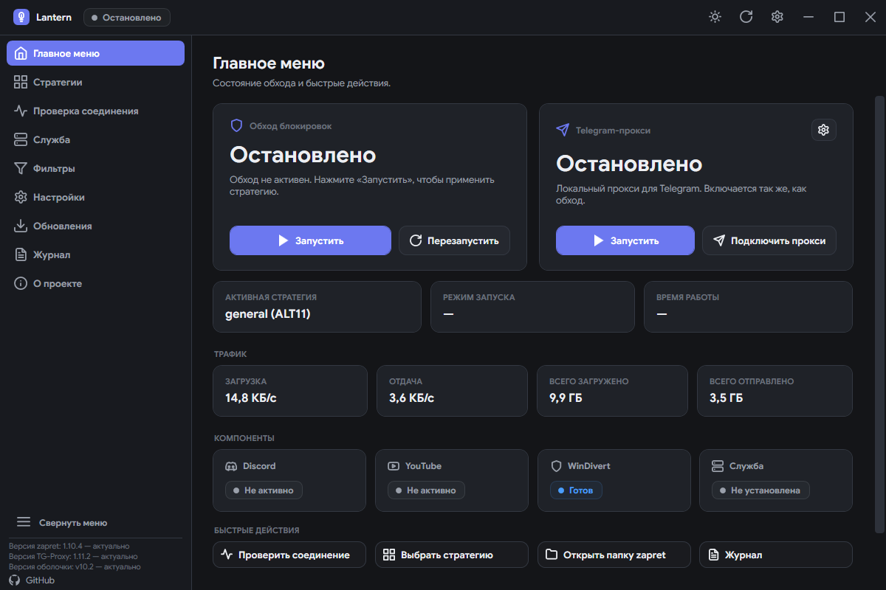
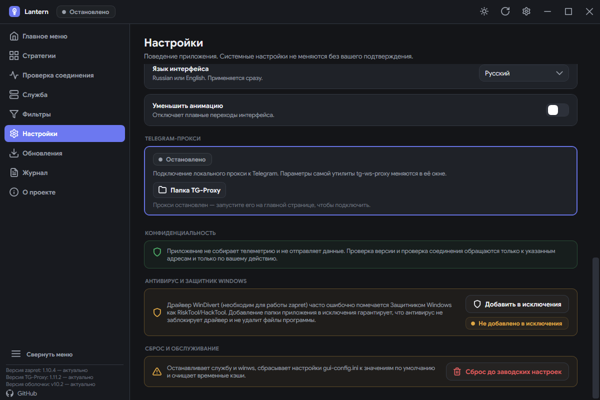
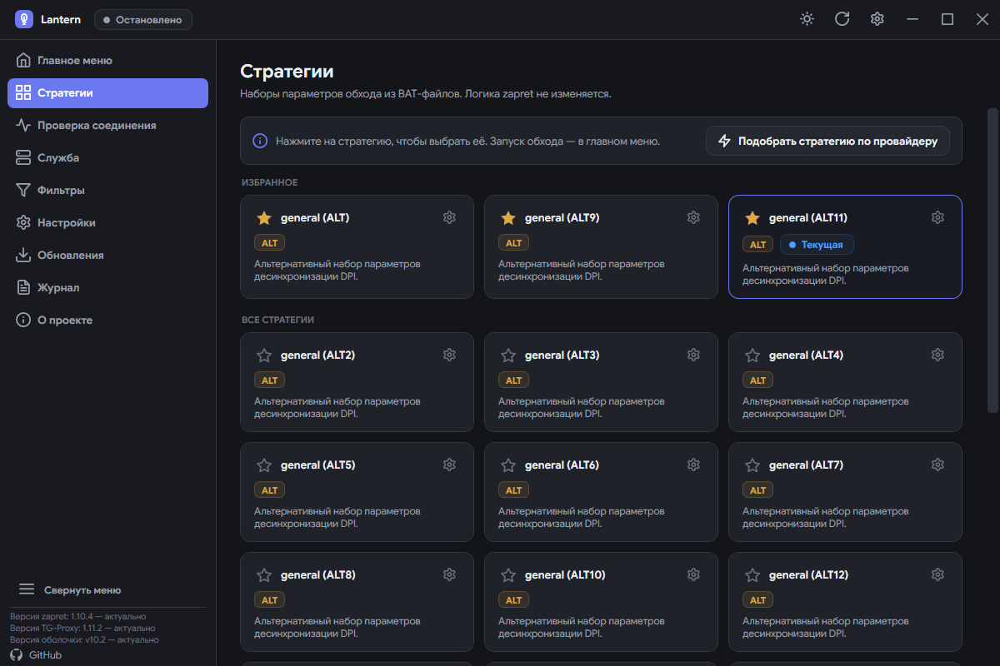
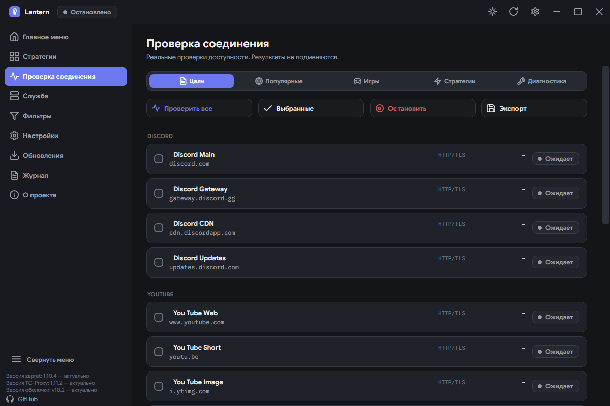
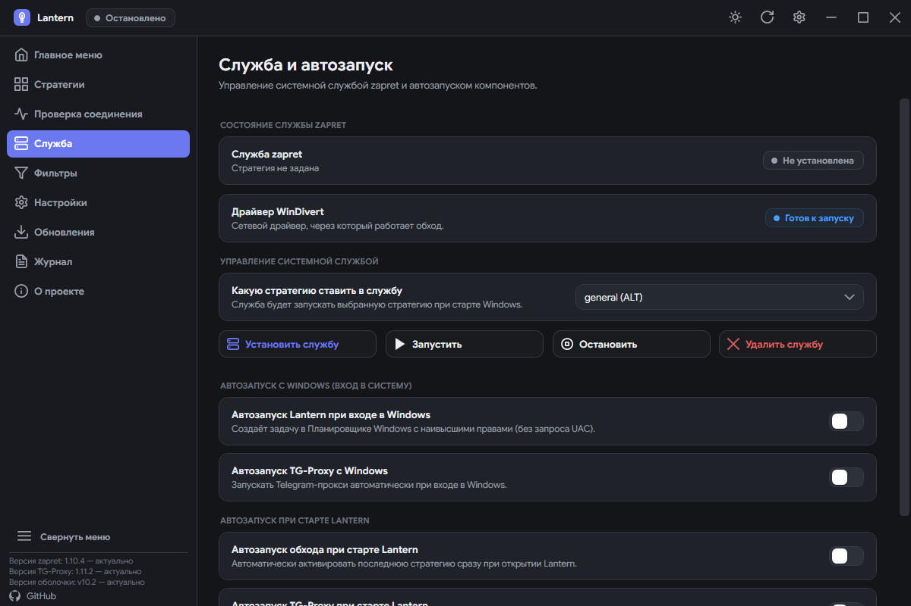
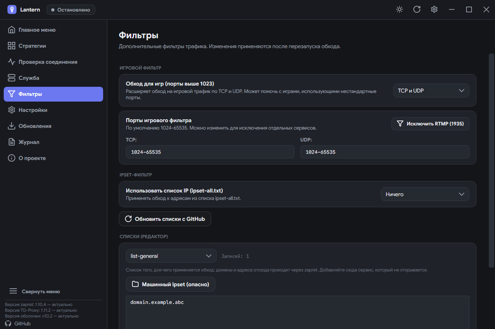
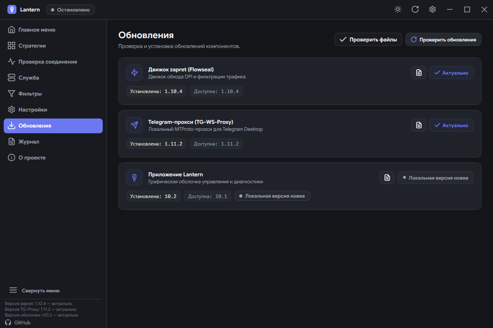
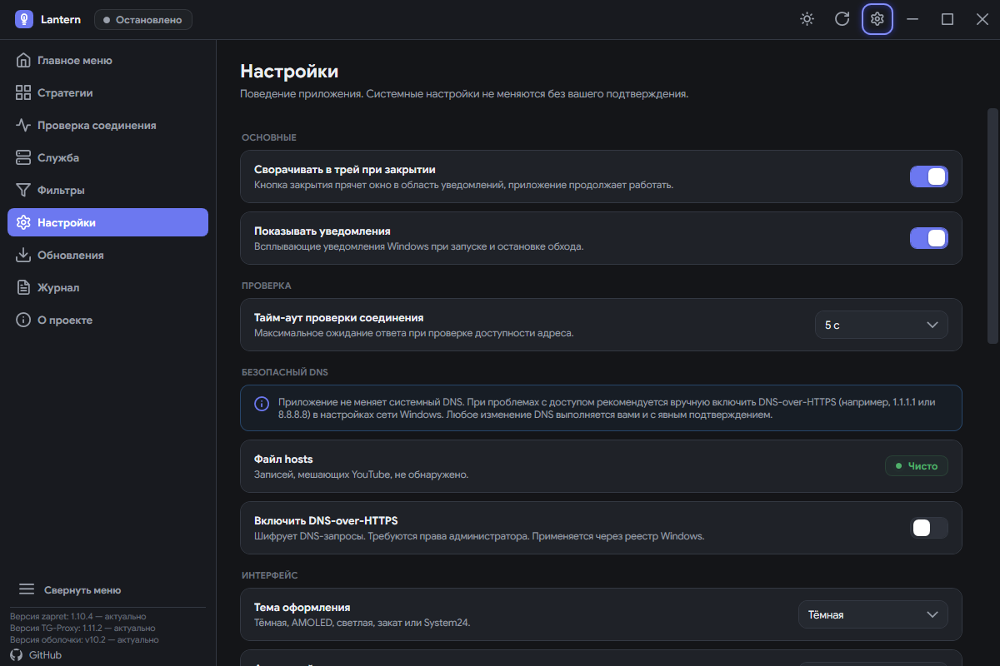
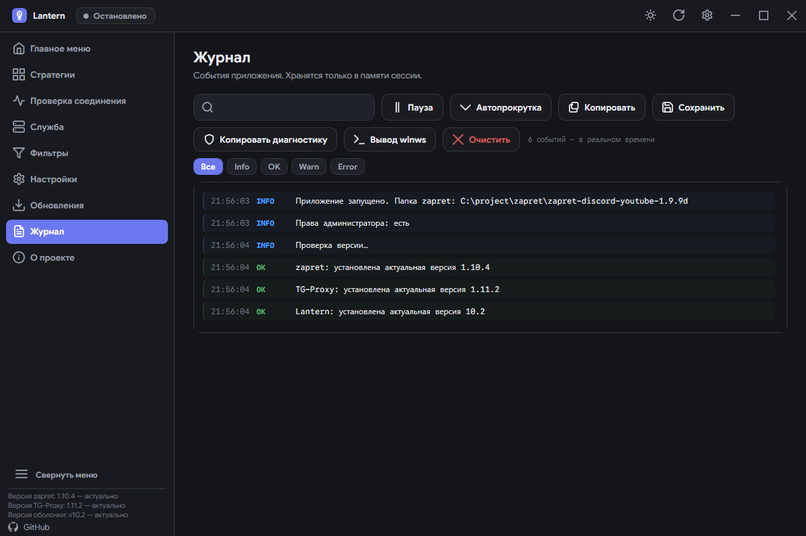
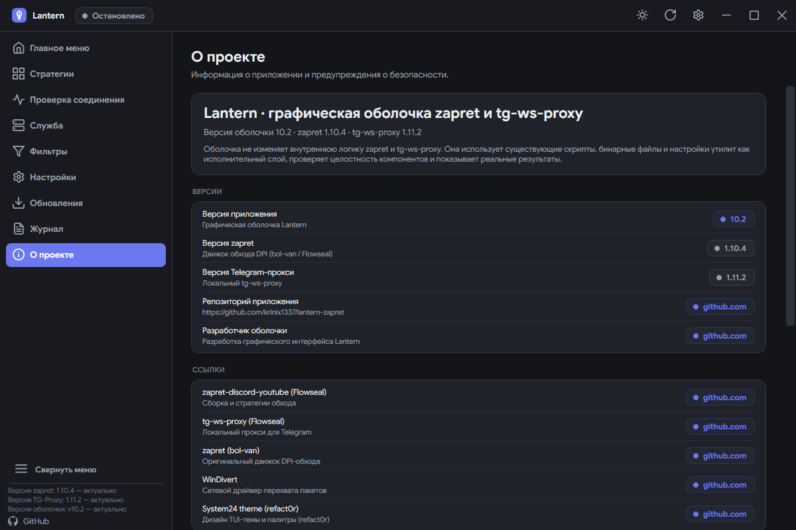

# 📖 Руководство пользователя Lantern

### Подробное иллюстрированное руководство по всем разделам, функциям и настройкам

 

[**🏠 Главная**](../README.md) • [**📖 Руководство**](guide.md) • [**🎨 Галерея тем**](themes.md) • [**🚀 Установка**](../README.md#-установка-и-первый-запуск) • [**⬇️ Релизы**](https://github.com/krinix1337/lantern-zapret/releases)

 

---

## 📑 Содержание

1. [🛡️ Важные рекомендации перед началом](#️-важные-рекомендации-перед-началом)
2. [🏠 Главный экран (Обзор)](#-главный-экран-обзор)
3. [🧩 Каталог стратегий и быстрое редактирование](#-каталог-стратегий-и-быстрое-редактирование)
4. [🔎 Проверка соединения и диагностика](#-проверка-соединения-и-диагностика)
5. [⚙️ Служба Windows (Автозапуск)](#️-служба-windows-автозапуск)
6. [🎛️ Управление фильтрами и списками](#️-управление-фильтрами-и-списками)
7. [🔄 Центр обновлений](#-центр-обновлений)
8. [⚙️ Настройки и оптимизация](#️-настройки-и-оптимизация)
9. [⌨️ Навигация с клавиатуры и доступность](#️-навигация-с-клавиатуры-и-доступность)
10. [📋 Журнал событий](#-журнал-событий)
11. [ℹ️ Безопасность и проверка целостности](#ℹ️-безопасность-и-проверка-целостности)
12. [❓ Решение частых проблем (FAQ)](#-решение-частых-проблем-faq)

---

## 🛡️ Важные рекомендации перед началом

Перед началом активного использования Lantern обратите внимание на несколько ключевых моментов:

> [!IMPORTANT]
> **Всегда запускайте Lantern от имени Администратора.**
> Сетевой драйвер `WinDivert64.sys`, установка системной службы Windows и включение системного `DNS-over-HTTPS` требуют административных прав.

> [!WARNING]
> **Не запускайте несколько копий `winws.exe` одновременно.**
> Если у вас уже запущена служба zapret или открыт консольный BAT-скрипт из другой папки, они будут конфликтовать за захват сетевых пакетов через WinDivert. Перед запуском ручного режима в Lantern остановите службу.

> [!TIP]
> **После изменения фильтров требуется перезапуск.**
> При изменении игрового фильтра (TCP/UDP) или списков IPSet необходимо перезапустить текущий обход на главном экране (или перезапустить службу), чтобы новые параметры вступили в силу.

---

## 🏠 Главный экран (Обзор)

Раздел **Обзор** — это центральный пульт управления состоянием вашей системы обхода.

### Основные элементы:
- **Карточка zapret**:
  - Отображает текущее состояние (`Запущено` / `Остановлено` / `Запуск...`), активную стратегию, режим работы (ручной запуск или системная служба) и время непрерывной работы (uptime).
  - Кнопка **«Запустить / Остановить»** переключает процесс.
  - Кнопка **«Перезапуск»** быстро перезапускает `winws.exe` с применением обновленных настроек (с плавной анимацией вращения иконки на 360°).
- **Карточка Telegram Proxy**:
  - Позволяет в один клик запустить или остановить утилиту `tg-ws-proxy` (Flowseal) для снятия ограничений скорости с медиафайлов в Telegram Desktop.
  - Кнопка **«Подключить прокси»** открывает ссылку `tg://proxy` в клиенте Telegram по умолчанию; клиент покажет диалог добавления прокси. Кнопка активна, когда прокси запущен.
  - Шестерня в шапке карточки открывает раздел **«Telegram-прокси»** в настройках, прокручивает к нему и подсвечивает. Там — статус, найденные клиенты (Telegram Desktop, AyuGram, 64Gram, Kotatogram), копирование ссылки и папка утилиты; кнопки клиентов появляются при запущенном прокси. Раздел открывается и при остановленном прокси, а для клиентов из Microsoft Store (например, Unigram) доступно копирование ссылки.
  - Если компонент еще не скачан, Lantern предложит автоматически загрузить его из официального репозитория.

- **Счетчики сетевого трафика**:
  - Демонстрируют текущую скорость входящего/исходящего трафика и общий объем переданных данных с момента запуска приложения.
- **Индикаторы системных компонентов**:
  - Быстрый статус доступности Discord, YouTube, драйвера `WinDivert` и фоновой службы.
- **Статус в шапке**:
  - Плашка объединяет состояние обхода и Telegram-прокси: «Остановлено», «Обход запущен», «TG-прокси запущен» или «Обход и TG запущены». Цвет соответствует теме и выбранному акценту.

---

## 🧩 Каталог стратегий и быстрое редактирование

Вкладка **Стратегии** содержит полный перечень встроенных конфигураций `general*.bat` для обхода блокировок.

### Возможности раздела:
1. **Категории стратегий (по именам файлов)**:
   - `General` — базовая универсальная стратегия.
   - `ALT` (ALT2–ALT12) — альтернативные алгоритмы фрагментации и модификации TCP/UDP заголовков.
   - `FAKE` (FAKE TLS AUTO и др.) — отправка поддельных TLS ClientHello для обхода жестких DPI-фильтров провайдеров.
   - `SIMPLE` — упрощенные профили обхода с минимальной нагрузкой на процессор.
2. **⚙️ Быстрое редактирование в Блокноте**:
   - Каждая карточка стратегии оснащена кнопкой-шестерёнкой ⚙️. Клик по ней мгновенно открывает соответствующий `.bat`-файл в Блокноте для тонкой ручной правки без риска случайно переключить активную стратегию.
3. **🌐 Умная рекомендация по провайдеру (ISP)**:
   - Нажмите кнопку поиска рекомендации: Lantern безопасно определит вашего провайдера через зашифрованный запрос и порекомендует стратегию, статистически показавшую наибольшую эффективность (например, FAKE TLS для Ростелекома, МТС, Билайна).
4. **⭐ Избранное**:
   - Звёздочка на карточке выносит стратегию в отдельную секцию «Избранное» над общим списком; в «Все стратегии» она не дублируется.
   - Снятие звезды возвращает карточку в общий список; выбор сохраняется в `gui-config.ini` и перечитывается при открытии раздела.

---

## 🔎 Проверка соединения и диагностика

Раздел **Проверка соединения** предназначен для всестороннего тестирования доступности заблокированных ресурсов, выявления проблем сетевого окружения и сравнения эффективности разных стратегий.

### Вкладки раздела:

| Вкладка | Назначение |
| :--- | :--- |
| 📋 **Цели** | Проверка хостов из вашего конфигурационного файла `utils/targets.txt`. |
| 🌐 **Популярные сервисы** | Быстрый тест Discord, YouTube, Cloudflare и других популярных сервисов. |
| 🎮 **Игровые серверы** | Проверка серверов популярных онлайн-игр (Steam, Riot, EA, Blizzard). |
| ⚡ **Тест стратегий (Бенчмарк)** | Автоматический последовательный прогон всех доступных BAT-стратегий с замером задержки и процента успешности. |
| 🩺 **Диагностика системы** | Полная проверка сетевого стека Windows, автоопределение конфликтов и инструменты быстрого ремонта в 1 клик. |

### Групповая проверка и отчёты:
- **Массовая проверка**: отметьте нужные стратегии галочками и нажмите «Выбранные»; «Проверить все» прогоняет весь список, «Остановить» прерывает прогон.
- **Рабочие в избранное**: после завершённой проверки появляется кнопка «Рабочие в избранное (N)» — она добавляет только стратегии, прошедшие все цели, без дублей.
- **Отчёт**: результаты пакетной проверки и автоподбора сохраняются в `utils\test results\test_results_ГГГГ-ММ-ДД_ЧЧ-ММ-СС.txt` — в том же каталоге, что у `service.bat`; в файле цели с кодами и временем, аналитика и лучшая стратегия.

### Инструменты вкладки «Диагностика»:
1. **🧪 Тест DPI Freeze**:
   - Отправка пробного пакета 64 КБ для выявления скрытых разрывов ТСПУ на 16–20 пакетах.
2. **🗑️ Очистка кэша Discord**:
   - Удаление временных файлов кэша (`Cache`, `Code Cache`, `GPUCache`) для всех редакций Discord (Stable, PTB, Canary, Development) с подсчётом удалённых файлов.
3. **🔄 Сброс WinDivert**:
   - Безопасная выгрузка и удаление зависших драйверов `WinDivert` и `WinDivert14` из реестра и диспетчера служб в 1 клик.
4. **🔍 Глубокий аудит окружения**:
   - Автоматическая проверка активности службы BFE, системного прокси (с кнопкой автоотключения), TCP Timestamps (с кнопкой автовключения), конфликтов с AdGuard, VPN-сервисами (Happ, Amnezia, WireGuard, V2RayTun, Incy и др.), Killer Network, SmartByte, а также проверка на наличие кириллических символов в путях и нахождение в каталоге OneDrive.

> [!NOTE]
> **Как работает бенчмарк стратегий:**
> Lantern временно останавливает текущий обход, по очереди запускает каждую стратегию, ожидает инициализации `winws.exe` (5 сек.), отправляет HTTP/1.1, TLS 1.2 и TLS 1.3 запросы через сокеты и `curl.exe`, фиксирует задержку (Ping / RTT) и выстраивает рейтинг самых стабильных стратегий.

---

## ⚙️ Служба Windows (Автозапуск)

Установка Lantern в качестве **системной службы Windows** позволяет `winws.exe` стартовать автоматически при загрузке компьютера еще до входа пользователя в систему. В этом же разделе централизованно настраивается поведение фонового автозапуска.

### Как настроить службу и автозапуск:
1. **Установка системной службы**:
   - Выберите нужную стратегию в выпадающем списке раздела **Служба**.
   - Нажмите кнопку **«Установить службу»**.
   - Lantern создаст службу с именем `zapret`, настроит автозапуск (`start= auto`) и пропишет выбранную стратегию в системный реестр (`HKLM\System\CurrentControlSet\Services\zapret`).
   - Для удаления службы достаточно нажать кнопку **«Удалить»**.
2. **Детект сторонней службы zapret**:
   - Если в системе уже установлена служба `zapret` из другой папки или сторонней сборки, Lantern автоматически обнаружит её и выведет предупреждающий баннер с кнопками **«Взять под управление»** (мгновенно переключает службу на Lantern) или **«Удалить»**.
3. **Единое управление автозапуском**:
   - **Автозапуск службы при старте системы** — служба `winws.exe` стартует как фоновый сервис Windows без необходимости открывать окно программы.
   - **Автозапуск приложения Lantern в трей** — добавление задачи в планировщик Windows (`LanternAutostart` с наивысшими правами) для автоматического запуска Lantern в трей при входе в систему.

---

## 🎛️ Управление фильтрами и списками

Раздел **Фильтры** позволяет тонко настраивать параметры перехвата пакетов и управлять файлами доменов.

### 1. Игровой фильтр (Game Filter)
- `Выключен` — обрабатывается только стандартный веб-трафик (порты 80, 443).
- `TCP и UDP` — перехват и обход на динамических игровых портах `1024-65535`.
- `Только TCP` / `Только UDP` — выборочная фильтрация игровых протоколов.
- Поля `TCP` и `UDP` под списком позволяют вручную задать диапазоны игровых портов (по умолчанию `1024-65535`), чтобы исключить вмешательство в голосовые чаты и сетевую синхронизацию игр.

### 2. IPSet-фильтр
- `Загруженный список` — фильтрация применяется только к адресам из файла `lists/ipset-all.txt`.
- `Ничего` — IPSet-правила не используются; исходный список сохраняется в резервной копии.
- `Любой IP` — обход применяется ко всем адресам.
- `Кнопка «Обновить списки с GitHub»` — автоматическая подгрузка свежих баз IPSet.

### 3. Визуальный редактор списков
- Позволяет просматривать, добавлять и удалять домены прямо из интерфейса для файлов `list-general-user.txt`, `list-exclude-user.txt` и `ipset-exclude-user.txt`.

---

## 🔄 Центр обновлений

Отдельный специализированный раздел **Обновления** обеспечивает централизованное обновление всех компонентов системы:

### Возможности:
- **Раздельные карточки компонентов**:
  - `Движок zapret (Flowseal)` — ядро DPI-фильтрации и актуальные наборы десинхронизационных BAT-стратегий.
  - `Telegram-прокси (TG-WS-Proxy)` — локальный MTProto-прокси для Telegram Desktop.
  - `Оболочка Lantern` — само графическое приложение.
- **Индикация версий**: отображение локальной версии, доступного релиза на GitHub и статусных меток актуальности.
- **Прогресс загрузки в реальном времени**: во время скачивания отображаются текущая скорость (**МБ/с**), точный размер скачанного файла (**X / Y МБ**) и анимированная полоса выполнения.
- **Устойчивость к лимиту GitHub API**: ответы релизов кэшируются на 10 минут; при исчерпанном лимите показываются последние полученные данные, а не ошибка 403.
- **Строгая верификация SHA-256**: контрольная сумма архива берётся из `digest` соответствующего ассета в GitHub Releases API. Установка без подтверждённого хэша блокируется — фолбэка «скачать без проверки» нет.
- **Проверка файлов и восстановление**: карточки движка и TG-прокси проверяют наличие и целостность файлов. Для движка проверяются обязательные файлы `bin/`, а если в поставке есть `SHA256SUMS.txt` — ещё и их хэши; сам архив при скачивании сверяется по digest GitHub. TG-прокси проверяется по SHA-256, сохранённому при установке или обновлении. При повреждении показывается статус «Повреждён» и кнопка «Восстановить», а подробности пишутся в журнал. Проверка запускается при открытии раздела и по кнопке «Проверить файлы».
- **Изолированная безопасная распаковка**: распаковка архива производится во временный каталог с защитой структуры файлов.
- **Безопасное обновление при запущенном обходе**: если запущен `winws` или системная служба, приложение останавливает их, дожидается реального `STOPPED` и выгружает драйвер WinDivert (`WinDivert`/`WinDivert14`), чтобы освободить `WinDivert64.sys`. После установки возвращается прежний режим (служба или ручная стратегия). Если драйвер не отдаёт файл, обновление отменяется с причиной в журнале, а не оставляет установку из двух версий.
- **Что обновлялось**: кнопка истории у каждой карточки показывает последние релизы компонента с датами и описанием, а «Показать все релизы» ведёт на страницу релизов репозитория.

---

## ⚙️ Настройки и оптимизация

Раздел настроек обеспечивает детальную кастомизацию работы программы, визуального оформления, системной безопасности и оптимизации ресурсов.

### Ключевые возможности:
- **⚡ Экстремальная оптимизация ОЗУ (RAM)**:
  - Автоматическое усечение рабочего набора памяти (`Core.TrimMemory()`) при минимизации или сворачивании окна в системный трей.
- **📐 Адаптивный размер окна и защита вёрстки**:
  - Минимальные габариты окна 760×480 пикселей синхронизированы с системным масштабированием Windows (DPI через Win32 `WM_GETMINMAXINFO`).
  - Ширина, высота и состояние «развёрнуто» записываются при изменении размера, сворачивании/разворачивании, завершении сеанса Windows и закрытии; при развёрнутом окне сохраняется обычный размер, а при следующем запуске геометрия восстанавливается с клампом по рабочей области.
  - Проверяется видимость всех 9 навигационных разделов, кнопки сворачивания сайдбара, версий компонентов и ссылки на GitHub при типовых размерах окна.
- **🎛️ Оформление и компактный режим**:
  - Пять тем, семь палитр System24, акцентные цвета и шрифты Google Sans / Unbounded / Onest / Golos Text / Literata; скачанный шрифт применяется сразу, в том числе после обновления.
  - «Компактный интерфейс» уменьшает шрифты, шапку, навигацию, кнопки, тумблеры, списки, отступы и карточки — весь интерфейс, а не только часть отступов.
- **🎬 Кинематографичные переходы и сохранение позиции**:
  - Плавный переход между темами и языками с круговым раскрытием (Circular Reveal) и затуханием.
  - Позиция прокрутки страниц сохраняется с точностью до пикселя при смене тем и языков.
  - Полная поддержка режима «Уменьшение движения» (`reduce_motion`): анимации и акцентная подсветка кнопок, выпадающих списков и переключателей мгновенно отключаются при активации соответствующей системной опции.
- **🛡️ Защитник Windows (Windows Defender)**:
  - Добавление папки приложения в исключения Защитника Windows в 1 клик для предотвращения блокировки драйвера `WinDivert64.sys`.
- **🌐 DNS-over-HTTPS (DoH)**:
  - Включается в блоке «Безопасный DNS»: системный резолвинг Windows через `Dnscache\Parameters\EnableAutoDOH`.
  - Предотвращает перехват и подмену DNS-ответов провайдером.
- **🔄 Сброс до заводских настроек (Factory Reset)**:
  - Безопасная очистка локальной конфигурации, остановка обхода и возврат параметров к состоянию по умолчанию с диалогом подтверждения.

---

## ⌨️ Навигация с клавиатуры и доступность

Lantern v10.2 предоставляет полноценную поддержку управления с клавиатуры для высокой скорости работы и доступности:

- **Перемещение фокуса (`Tab` и `Shift + Tab`)**:
  - Сквозная навигация по всем интерактивным элементам (кнопки, вкладки, поля ввода, карточки) без застреваний и повторных остановок фокуса.
- **Тумблеры и переключатели**:
  - Мгновенное переключение состояния клавишей `Enter` или `Пробел`.
- **Выпадающие списки (`ComboBox`)**:
  - `Alt + ↓`, `Enter` или `Пробел` — развернуть список вариантов.
  - `↑` / `↓` — выбор пункта.
  - `Enter` — подтверждение выбора и закрытие списка.
  - `Tab` — подтверждение выбора и переход к следующему элементу управления.
  - `Escape` — отмена выбора и закрытие списка.
- **Карточки стратегий**:
  - Полностью фокусируются с клавиатуры, активация стратегии по нажатию `Enter` или `Пробел`.

---

## 📋 Журнал событий

Раздел **Лог** фиксирует все происходящие события в реальном времени:

- `[INFO]` — информационные сообщения о запуске и переключении модулей.
- `[OK]` — успешное завершение операций, прохождение проверок соединения.
- `[WARN]` — предупреждения о таймаутах, конфликтах или отсутствии прав.
- `[ERROR]` — критические ошибки (сбои драйвера WinDivert, синтаксические ошибки параметров).

> [!TIP]
> **Кнопка «Диагностика»**:
> Формирует подробный отчет о конфигурации вашей системы, версии Windows, статусе службы, наличии драйвера и последних 40 событиях лога с автоматическим маскированием персональных путей. Этот отчет можно скопировать при обращении в поддержку или создании Issue.

---

## ℹ️ Безопасность и проверка целостности

Раздел **«О программе»** объединяет информацию о лицензии, версии компонентов и аутентичности файлов.

- **Проверка контрольных сумм SHA-256**: в один клик проверяет обязательные файлы движка; если в поставке есть `SHA256SUMS.txt`, сверяет и хэши файлов `bin/`.
- **Никаких сторонних серверов**: Lantern не перенаправляет ваш трафик через сторонние серверы — весь обход выполняется локально с помощью драйвера WinDivert.
- **Открытый исходный код**: исходный код полностью открыт для аудита в каталоге `_app`.

---

## ❓ Решение частых проблем (FAQ)

<b>1. Ошибка: WinDivert не загружается или код ошибки 5 / 577</b>

- Убедитесь, что Lantern запущен **от имени администратора**.
- Проверьте, что ваш антивирус не заблокировал драйвер `bin/WinDivert64.sys` (добавьте папку программы в исключения).
- Убедитесь, что в системе не работают другие программы на базе WinDivert (GoodCheck, старые версии zapret).

<b>2. Discord подключается к голосовому каналу бесконечно (RTC Connecting / No Route)</b>

- Перейдите в раздел **Фильтры** и переключите **Игровой фильтр** в режим `TCP + UDP` или `Только UDP`.
- Перезапустите обход на главном экране.
- Попробуйте стратегии из категории `ALT` (например, `general (ALT11).bat` или `general (ALT4).bat`).

<b>3. YouTube не открывается или видео грузятся бесконечно</b>

- Проверьте статус файла `hosts` в **Настройках** (он не должен содержать старых заглушек для googlevideo).
- Включите **DNS-over-HTTPS** в разделе **Настройки → Безопасный DNS**.
- Запустите **Бенчмарк стратегий** в разделе **Проверка соединения**, чтобы найти стратегию с наименьшей задержкой для YouTube CDN.

<b>4. Предупреждение Windows SmartScreen («Защитник Windows защитил ваш компьютер»)</b>

- **Причина**: Инсталлятор `Lantern-Setup.exe` распространяется бесплатно как проект с открытым исходным кодом. У него нет дорогостоящего ежегодного коммерческого EV-сертификата Microsoft (стоимостью более \$500/год), поэтому встроенная система SmartScreen перестраховывается на новых релизах.
- **Как запустить**: Нажмите на ссылку **«Подробнее»** в окне предупреждения SmartScreen, а затем на появившуюся кнопку **«Выполнить в любом случае»**.
- **Проверка подлинности**: Вы всегда можете сверить хэш скачанного файла с официальным файлом `Lantern-Setup.exe.sha256` со [страницы релизов](https://github.com/krinix1337/lantern-zapret/releases) либо загрузить файл на [VirusTotal](https://www.virustotal.com).

<b>5. Антивирус блокирует драйвер WinDivert64.sys или папку приложения</b>

- **Причина**: Драйвер `WinDivert` осуществляет локальный перехват и модификацию пакетов сетевого стека на уровне ядра (Ring 0) для нейтрализации блокировок DPI. Некоторые эвристические анализаторы антивирусов могут воспринимать это как подозрительную сетевую активность (ложное срабатывание / False Positive).
- **Решение**: Перейдите в **Настройки → Антивирус и Защитник Windows** и нажмите **«Добавить в исключения Защитника»** либо вручную внесите папку программы в белый список вашего стороннего антивируса.

---

[**🏠 Вернуться на главную**](../README.md) • [**🎨 Перейти в галерею тем**](themes.md) • [**⭐ Проект на GitHub**](https://github.com/krinix1337/lantern-zapret)

