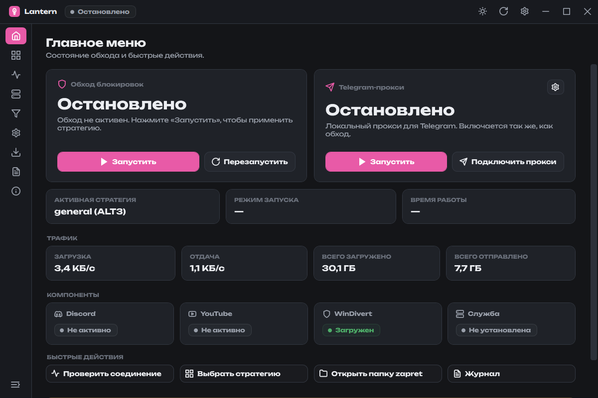
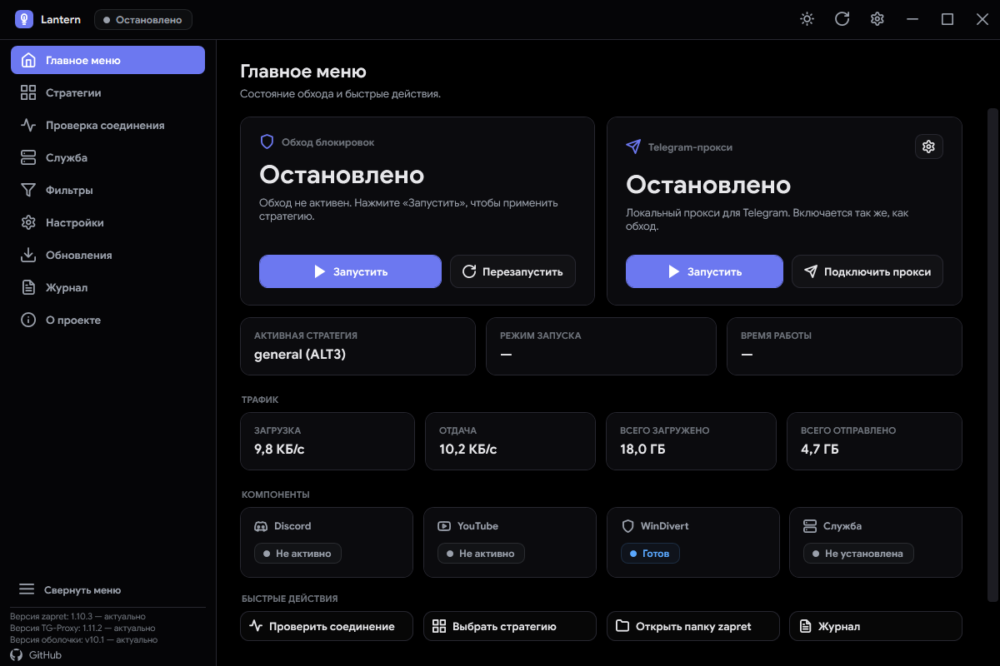
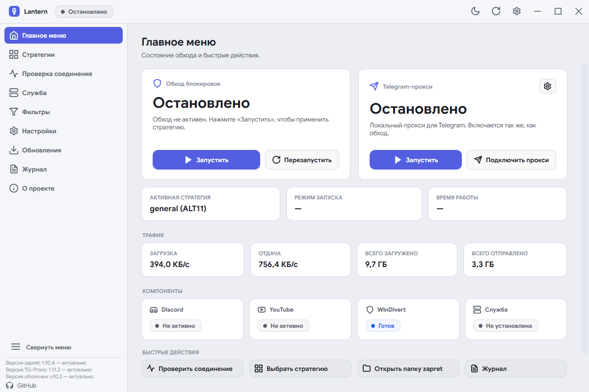
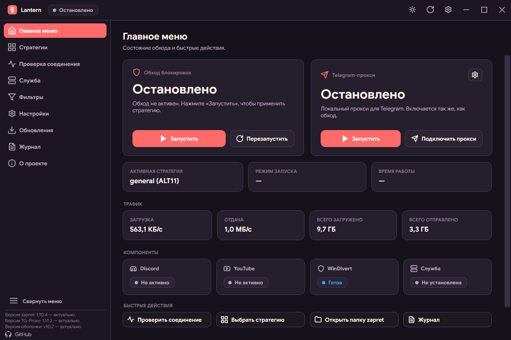
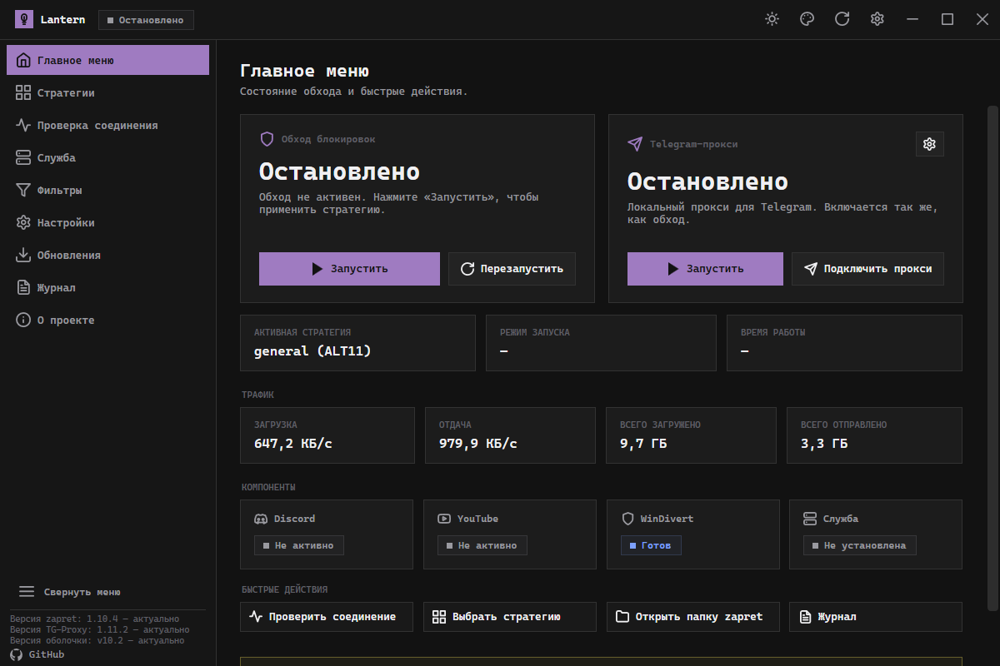

# 🎨 Галерея тем оформления Lantern

### Персонализируйте внешний вид приложения под ваше окружение и настроение

 

[**🏠 Главная**](../README.md) • [**📖 Руководство**](guide.md) • [**🎨 Галерея тем**](themes.md) • [**🚀 Установка**](../README.md#-установка-и-первый-запуск) • [**⬇️ Релизы**](https://github.com/krinix1337/lantern-zapret/releases)

 

---

## ⚡ О дизайне и переключении тем

Lantern оснащён **динамической дизайн-системой**:
- 🎨 **Векторные иконки**: чёткие контуры с живыми микро-анимациями при наведении во всех темах.
- 🔄 **Мгновенное переключение без перезапуска**: палитра применяется сразу, а смена темы сопровождается круговым раскрытием интерфейса.
- 🪟 **Стилизованный ScrollBar**: полоса прокрутки автоматически адаптируется под контрастность выбранной темы.
- 🌟 **Скругления DWM Windows 11**: нативные плавные углы окна и карточек.
- 💡 **Информативный ToolTip**: подсказка на кнопке смены темы заранее показывает название следующей темы.

> [!TIP]
> Выбрать тему можно в **Настройки → Интерфейс → Тема оформления** либо быстрым кликом по иконке темы (☀️ / 🌙) в правом верхнем углу окна.

---

## 📊 Сводная таблица тем

| Тема | Фон (Base) | Карточка (Surface) | Акцент (Accent) | Рекомендуемое окружение |
| :--- | :---: | :---: | :---: | :--- |
| 🌙 **Тёмная** | `#181A1F` | `#1F2228` | `#6C78F0` *(Indigo)* | Универсальная классическая тема |
| 🖤 **AMOLED** | `#000000` / `#050507` | `#0B0B0E` | `#6C78F0` *(Indigo)* | OLED / Mini-LED экраны, работа в темноте |
| ☀️ **Светлая** | `#F5F6FA` | `#FFFFFF` | `#535FE0` *(Cobalt)* | Яркое дневное освещение |
| 🌅 **Закат** | `#1B1622` | `#241E2D` | `#FF6B6B` *(Coral/Peach)* | Тёплый вечерний неоновый стиль (Tokyo Night) |
| 📟 **System24** | `#161616` | `#1C1C1C` | `#9F7BC1` *(Lavender)* | BetterDiscord TUI-стиль, моноширинный шрифт, прямые углы (unrounding), 7 палитр |

---

## 🌙 1. Тёмная (Dark)

Базовая сбалансированная тема Lantern. Графитовый тёмный фон снижает нагрузку на зрение, а мягкий индиго-акцент выделяет ключевые элементы управления.

---

## 🖤 2. AMOLED (True Black)

Тема для OLED и Mini-LED матриц, собранная по правилам настоящей AMOLED-палитры, а не «тёмной, только чернее»:

- **Фон окна и холст контента — `#000000`**: пиксели выключены, расход заряда минимальный, выгорание не грозит.
- **Карточки почти чёрные (`#0B0B0E`)**, объём задаёт тонкая рамка, а не серая заливка — серые плашки на OLED светятся и убивают смысл темы.
- **Все серые тона нейтральные**, без синего подтона: на чистом чёрном синева читается как грязь.
- **Текст `#E6E6E9`, а не `#FFFFFF`**: чистый белый на выключенном чёрном даёт гало и утомляет глаза.
- **Статусы чуть ярче, чем в тёмной теме** — светлой подложки-карточки вокруг них больше нет.

---

## ☀️ 3. Светлая (Light)

Чистая и контрастная светлая палитра, идеально подходящая для работы при ярком естественном или офисном освещении. Карточки чётко очерчены мягкими границами.

---

## 🌅 4. Закат (Sunset / Tokyo Night)

Тёплая сумеречная тема в стиле ночного Токио: глубокий баклажаново-сливовый фон в сочетании с ярким закатным кораллово-персиковым неоном. Создаёт невероятно уютную атмосферу для вечернего гейминга и отдыха.

---

## 📟 5. System24 (BetterDiscord TUI Style)

Воспроизведение культовой темы [**system24** от refact0r](https://github.com/refact0r/system24) для BetterDiscord / Vencord с поддержкой всех оригинальных подтем (flavors):

- **Моноширинный интерфейс (TUI)**: весь текст приложения переключается на чистый моноширинный терминальный шрифт (`Cascadia Mono` / `Consolas` / `DM Mono`).
- **Строгие прямые углы (unrounding)**: нулевое скругление углов у всех карточек, кнопок, значков и плашек — фирменная геометрия BetterDiscord system24.
- **Поддержка 7 аутентичных подтем (flavors)**:
  - 💜 **Default (Lavender)**: чистый угольный фон с фирменным лавандовым акцентом (`#9F7BC1`).
  - ☕ **Catppuccin Mocha**: глубокий контрастный фон Mantle/Crust с лиловым акцентом Mauve (`#CBA6F7`).
  - 🌃 **Tokyo Night**: неоновый ночной стиль с ярким акцентом Cyan/Blue (`#7AA2F7`).
  - ❄️ **Nord**: легендарный полярный стиль Polar Night с морозным акцентом Frost Cyan (`#88C0D0`).
  - 🌸 **Rosé Pine**: тёмный хвойный фон с нежным пастельно-розовым акцентом Rose (`#EBBCBA`).
  - 🌲 **Everforest**: природный лесной фон с мягким зелёным акцентом (`#A7C080`).
  - 🎮 **Vencord (Discord)**: угольный фон с классическим фиолетово-синим Discord Blurple (`#5865F2`).
- **Быстрое переключение**: в шапке окна рядом с кнопкой темы появляется отдельная кнопка палитры с выпадающим списком подтем.
- **Глубокий матовый фон**: чистые тёмно-серые плоскости с тонкими чёткими рамками.
- **Discord-палитра статусов**: яркие цвета статусов с квадратными маркерами индикаторов.

---

[**🏠 Вернуться на главную**](../README.md) • [**📖 Перейти к руководству**](guide.md) • [**⭐ Проект на GitHub**](https://github.com/krinix1337/lantern-zapret)

